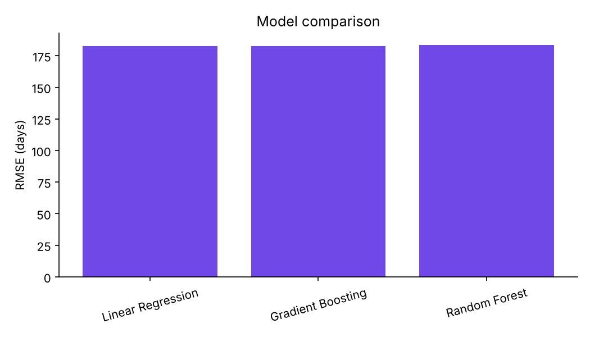
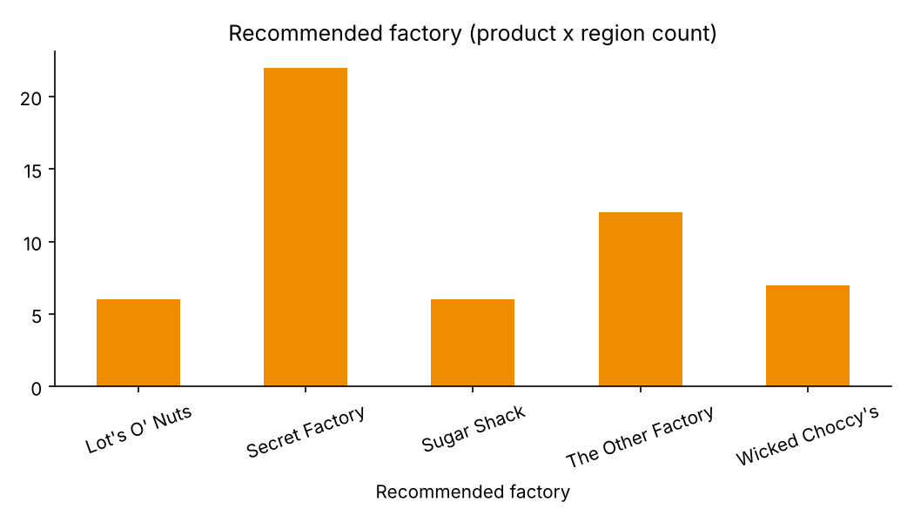

<div align="center">

# 🍬 Nassau Candy — Factory Reallocation & Shipping Optimization

**Predict · Simulate · Recommend** — a decision-intelligence system that tells leadership *which products should be made at which factory*.


</div>

---

## 🎯 Problem
Nassau Candy assigns products to factories with static, legacy rules → **suboptimal shipping distances, slow regions, and margin erosion**, with no way to simulate changes before executing them.

## ✨ What this project does
| Capability | How |
|---|---|
| 🔮 Predict lead time | Linear Regression (baseline), Random Forest, Gradient Boosting — best chosen on RMSE + interpretability |
| 🏭 Simulate reassignment | Re-scores every order as if made at each of the 5 factories (haversine distance recomputed) |
| ⭐ Recommend | Ranks factories by speed gain, profit (freight proxy) impact and capacity risk |
| 📊 Dashboard | Streamlit app with simulator, what-if, ranked suggestions, risk panel, overview |

## 🗂️ Project structure
```
nassau-candy-optimizer/
├── app.py                     # Streamlit dashboard
├── train.py                   # Full pipeline: train → simulate → reports/figures
├── requirements.txt
├── data/Nassau_Candy_Distributor.csv
├── src/
│   ├── config.py              # factories, product map, coordinates, assumptions
│   ├── data.py                # loading, cleaning, features, distance
│   ├── models.py              # model training & selection
│   └── simulate.py            # scenario engine, ranking, KPIs
├── models/best_model.joblib
└── reports/
    ├── research_paper.md
    ├── executive_summary.md
    ├── model_metrics.csv · recommendations.csv · summary.json
    └── figures/*.png
```

## 🚀 Quick start
```bash
python -m venv .venv && source .venv/bin/activate    # Windows: .venv\Scripts\activate
pip install -r requirements.txt
python train.py            # (optional) retrain + regenerate reports
streamlit run app.py
```

## 🧪 Method (step by step)
1. **Prepare** – lead time = Ship Date − Order Date; outlier filter; one-hot encode region / ship mode / product / factory; scale numerics.
2. **Model** – predict lead time from product, origin factory, destination region, ship mode, distance, units, order year.
3. **Evaluate** – RMSE, MAE, R² on an 80/20 split.
4. **Simulate** – for each product, swap the factory, recompute distance, predict again.
5. **Rank** – `score = w·speed + (1−w)·profit − risk penalty` (`w` = dashboard slider).

## 📈 Results
| Model | RMSE | MAE | R² |
|---|---|---|---|
| **Linear Regression** ✅ | 182.6 | 181.5 | 0.529 |
| Gradient Boosting | 182.8 | 180.7 | 0.527 |
| Random Forest | 183.6 | 179.5 | 0.523 |

| KPI | Value |
|---|---|
| Avg distance reduction (best alt. per product×region) | **27.9%** |
| Recommendations with freight saving | **79.2%** |
| Coverage (distance **and** profit gain) | **70%** |
| Scenario confidence (routes within observed range) | **74.7%** |
| Risk mix (53 recs) | 🟢 29 Low · 🟠 1 Medium · 🔴 23 High |

<p align="center">
 
</p>

## ⚠️ Data caveats (important)
- **Ship dates fall in 2026–2030** for 2024–2025 orders, giving "lead times" of ~900–1,640 days. This looks synthetic/mis-keyed.
- Lead time shows **no relationship** with distance, ship mode, region or factory (within-year R² ≈ 0). R² ≈ 0.53 only reflects the 2024-vs-2025 offset.
- So the **predicted lead-time gain (~0.2%) is not reliable**; the real signal is **distance and freight proxy**. Validate with true delivery timestamps before large moves.
- Freight cost (`$0.0004 / unit-km`) and capacity thresholds are **assumptions** — edit them in `src/config.py`.
- Customer location = state/province centroid (approximate).

## 🛣️ Next steps
Real freight rates · factory capacity data · true delivery dates · constrained optimizer (assignment LP) · SHAP explainability.

## 📄 Deliverables
- Research paper → `reports/research_paper.md`
- Streamlit dashboard → `app.py`
- Executive summary → `reports/executive_summary.md`

---
<div align="center">Built for the Unified Mentor project · Nassau Candy Distributor dataset</div>
